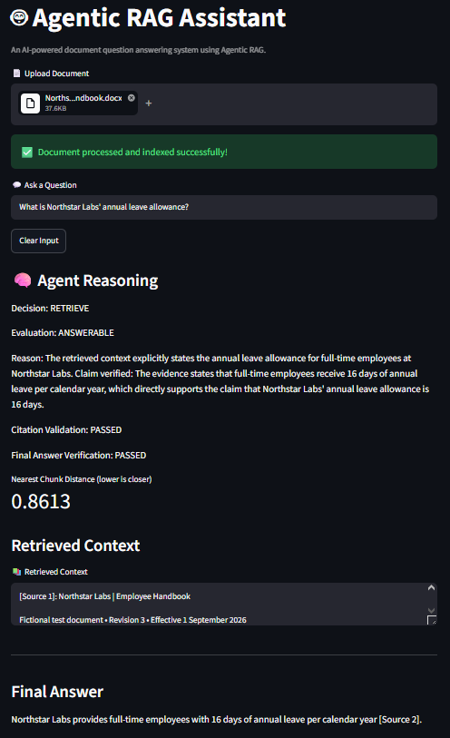
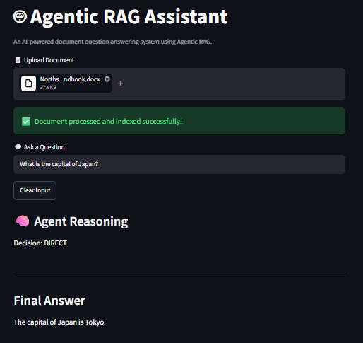
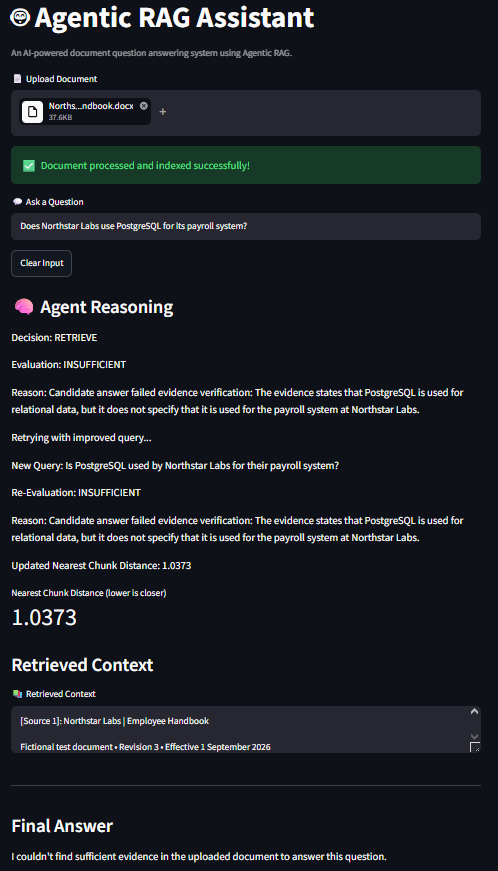

# Agentic RAG Assistant

A document question-answering application built with Python, Streamlit, OpenAI, LangChain, and FAISS.

The project explores a Retrieval-Augmented Generation (RAG) workflow with evidence evaluation, query rewriting, candidate-answer verification, and automated testing.

Its main objective is to improve the reliability of document-grounded answers by distinguishing directly supported information from missing information and unsupported assumptions.

## Features

- Upload and query `.txt` and `.docx` documents.
- Semantic document retrieval using OpenAI embeddings and FAISS.
- Document-grounded question answering.
- Structured evidence classification:
  - `ANSWERABLE` — sufficient evidence supports an answer.
  - `NOT_SPECIFIED` — the document explicitly states that the requested information is not provided.
  - `INSUFFICIENT` — the retrieved evidence cannot establish an answer.
- Evidence quotation validation against retrieved context.
- Candidate-answer verification to detect unsupported inferences.
- Automatic query rewriting and retrieval retry when evidence is insufficient.
- Source-referenced answer generation.
- Interactive Streamlit interface displaying reasoning steps and retrieved context.
- Automated evaluation with predefined test cases.

## How It Works

1. **Document processing:** Uploaded documents are converted into text and split into chunks.
2. **Embedding and indexing:** Document chunks are embedded and stored in a FAISS vector store.
3. **Retrieval:** When a document is available, the application searches for relevant chunks.
4. **Evidence evaluation:** An LLM classifies the retrieved evidence as `ANSWERABLE`, `NOT_SPECIFIED`, or `INSUFFICIENT`.
5. **Candidate-answer verification:** For `ANSWERABLE` results, a separate verification step checks whether the proposed answer follows from the selected evidence.
6. **Retrieval retry:** If evidence is insufficient or a claim fails verification, the system rewrites the question and retries retrieval once.
7. **Answer generation:** The application generates a grounded answer using retrieved context, or abstains when evidence remains insufficient.

When no document vector store is available, the application can use direct LLM answering.

The claim verifier adds an additional validation step, but it does not guarantee factual correctness. Final-answer citation validation remains a planned improvement.

## Project Structure

```text
agentic-rag-assistant/
├── app.py
├── evaluate.py
├── README.md
├── requirements.txt
├── .env.example
├── .gitignore
│
├── src/
│   ├── __init__.py
│   ├── agent.py
│   ├── config.py
│   ├── file_processor.py
│   └── vectorstore.py
│
├── tests/
│   └── test_cases.json
│
├── sample_documents/
│   ├── ai_overview.txt
│   ├── company_policy.docx
│   └── Northstar_Labs_RAG_Test_Handbook.docx
│
├── evaluation_results/
│   ├── results.csv
│   └── results.json
│
└── screenshots/
    ├── direct.png
    ├── retrieval.png
    └── retry.png
```

## Technologies

- Python
- Streamlit
- OpenAI API and embeddings
- LangChain
- FAISS
- python-dotenv
- docx2txt

## Installation

Clone the repository:

```bash
git clone https://github.com/iffaaaat/agentic-rag-assistant.git
cd agentic-rag-assistant
```

Create and activate a virtual environment:

```bash
python -m venv .venv
```

Windows:

```cmd
.venv\Scripts\activate
```

Install dependencies:

```bash
pip install -r requirements.txt
```

Create a `.env` file in the project root:

```env
OPENAI_API_KEY=your_api_key_here
```

Start the application:

```bash
python -m streamlit run app.py
```

An OpenAI API key with available API credits is required for embedding generation and LLM calls.

## Automated Evaluation

The project includes a fictional employee handbook designed for testing document retrieval, answerability, and unsupported inferences.

The evaluation dataset contains 20 questions covering:

- Directly answerable facts.
- Information explicitly identified as unavailable.
- Questions requiring abstention.
- Unsupported inferences involving company-wide technologies and specific systems.
- Distinctions between response targets and guaranteed resolution times.

Run the evaluation:

```bash
python evaluate.py --document sample_documents/Northstar_Labs_RAG_Test_Handbook.docx
```

Results are saved in `evaluation_results/`.

### Evaluation Results

| Version | Correct classifications | Accuracy |
|---|---:|---:|
| Before recent reliability improvements | 16/20 | 80% |
| After evidence normalization and claim verification | 19/20 | 95% |

The latest evaluation correctly rejected unsupported payroll-system assumptions while retaining supported answers about the engineering team's technologies.

**Limitations:** This is a small, manually designed benchmark. Several test cases informed the development process, so the reported accuracy should not be interpreted as performance on an independent dataset. One test involving the CEO's salary has an ambiguous expected classification and requires review.

The evaluation measures classification agreement, not comprehensive final-answer factual correctness or citation accuracy.

## Example Workflows

### Document Retrieval

The application retrieves relevant information from uploaded documents and generates source-referenced answers.



### Direct Answer

When no document is available, the system can answer general questions directly.



### Retrieval Retry

If the retrieved evidence is insufficient, or a proposed answer fails verification, the application rewrites the query and performs a second retrieval attempt.



## Known Limitations and Future Improvements

- Validate generated citation numbers and their relationship to supporting evidence.
- Verify final-answer claims after generation.
- Improve error handling and distinguish invalid model responses from insufficient evidence.
- Evaluate using additional unseen documents and test questions.
- Add PDF and multi-document support.
- Introduce persistent vector storage and optional conversation memory.
- Improve retrieval diagnostics and UI presentation.

## Project Purpose

This project is intended as an AI engineering portfolio demonstration of document retrieval, LLM orchestration, structured output validation, and evaluation-driven reliability improvements.

It is a learning and demonstration project rather than a production-ready document intelligence service.