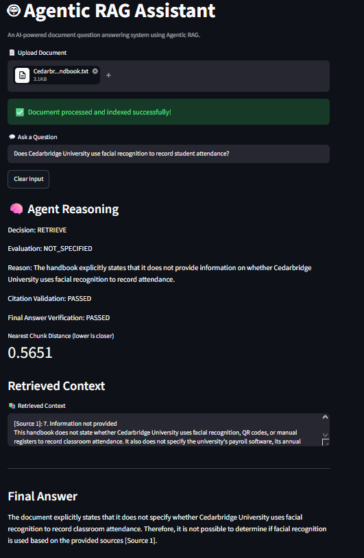

# Agentic RAG Assistant

A document question-answering application built with Python, Streamlit, OpenAI, LangChain, and FAISS.

The project explores an agentic-style Retrieval-Augmented Generation (RAG) workflow that combines LLM-based question routing, semantic retrieval, evidence evaluation, query rewriting, answer verification, and automated testing.

Its main objective is to improve the reliability of document-grounded answers by distinguishing directly supported information from missing information and unsupported assumptions.

## Features

- Upload and query `.txt` and `.docx` documents.
- Semantic document retrieval using OpenAI embeddings and FAISS.
- LLM-based routing between general knowledge and document retrieval.
- Document-grounded question answering with source references.
- Structured evidence classification:
  - `ANSWERABLE` — sufficient evidence supports an answer.
  - `NOT_SPECIFIED` — the document explicitly states that the requested information is not provided.
  - `INSUFFICIENT` — the retrieved evidence cannot establish an answer.
- Evidence quotation validation against retrieved context.
- Candidate-answer verification to detect unsupported inferences.
- Automatic query rewriting and one retrieval retry when evidence is insufficient.
- Citation-number validation with one automatic correction attempt.
- Final-answer verification against cited evidence.
- Interactive Streamlit interface displaying routing decisions, evaluation results, retrieved context, and final answers.
- Automated evaluation and unit tests covering reliability mechanisms.

## How It Works

1. **Document processing:** Uploaded `.txt` or `.docx` files are converted into text and split into chunks.
2. **Embedding and indexing:** Document chunks are embedded and stored in a FAISS vector store.
3. **Dynamic routing:** When a document is available, an LLM-based router decides whether the question requires document retrieval or can be answered directly using general knowledge. Ambiguous questions are instructed to prioritize retrieval.
4. **Retrieval:** Document-related questions retrieve relevant chunks from the FAISS vector store.
5. **Evidence evaluation:** Retrieved evidence is classified as `ANSWERABLE`, `NOT_SPECIFIED`, or `INSUFFICIENT`.
6. **Candidate verification:** For `ANSWERABLE` results, the proposed answer is checked against supporting evidence.
7. **Retrieval retry:** If evidence is insufficient or candidate verification fails, the query is rewritten and retrieval is attempted once more.
8. **Answer generation:** When sufficient evidence is available, an answer is generated using the retrieved context.
9. **Citation validation:** The application checks whether cited source numbers exist and attempts one regeneration if citations are missing or invalid.
10. **Final-answer verification:** The generated answer is checked against its cited evidence. If verification fails, the application abstains rather than returning the unsupported answer.

When no document is uploaded, the application uses direct LLM answering.

For questions clearly unrelated to an uploaded document, the `DIRECT` route bypasses document retrieval and document-grounding verification.

The router is designed to favor retrieval for document-specific or ambiguous questions. However, LLM-based routing and verification may still produce incorrect decisions.

## Project Structure

```text
agentic-rag-assistant/
├── app.py
├── evaluate.py
├── README.md
├── requirements.txt
├── .env.example
├── .gitignore
│
├── src/
│   ├── __init__.py
│   ├── agent.py
│   ├── evaluator.py
│   ├── citations.py
│   ├── llm_utils.py
│   ├── config.py
│   ├── file_processor.py
│   └── vectorstore.py
│
├── tests/
│   ├── test_cases.json
│   ├── test_citation_retry.py
│   ├── test_final_answer_verification.py
│   └── test_routing.py
│
├── sample_documents/
│   ├── ai_overview.txt
│   ├── company_policy.docx
│   ├── Northstar_Labs_RAG_Test_Handbook.docx
│   └── Cedarbridge_University_Student_Handbook.txt
│
├── evaluation_results/
│   ├── results.json
│   ├── results.csv
│   ├── results_phase3.json
│   └── results_phase3.csv
│
└── screenshots/
    ├── retrieval.png
    ├── direct.png
    ├── retry.png
    └── unseen_document.png
```

## Technologies

- Python
- Streamlit
- OpenAI API and embeddings
- LangChain
- FAISS
- python-dotenv
- docx2txt
- Python `unittest`

## Installation

Clone the repository:

```bash
git clone https://github.com/iffaaaat/agentic-rag-assistant.git
cd agentic-rag-assistant
```

Create a virtual environment:

```bash
python -m venv .venv
```

Activate it on Windows:

```cmd
.venv\Scripts\activate
```

Install dependencies:

```bash
pip install -r requirements.txt
```

Create a `.env` file in the project root:

```env
OPENAI_API_KEY=your_api_key_here
```

Start the application:

```bash
python -m streamlit run app.py
```

An OpenAI API key with available API credits is required for embedding generation and LLM calls.

## Automated Evaluation

The project includes a fictional Northstar Labs employee handbook and a 20-question benchmark designed to evaluate document retrieval, answerability classification, and unsupported inferences.

The benchmark covers:

- Directly answerable facts.
- Information explicitly identified as unavailable.
- Questions requiring abstention.
- Unsupported inferences about internal technologies and systems.
- Distinctions between response targets and guaranteed resolution times.

Run the evaluation:

```bash
python evaluate.py --document sample_documents/Northstar_Labs_RAG_Test_Handbook.docx
```

Results are saved in `evaluation_results/`.

### Benchmark Results

| Development stage | Correct classifications | Accuracy |
|---|---:|---:|
| Initial implementation | 16/20 | 80% |
| Evidence and claim verification improvements | 19/20 | 95% |
| Initial dynamic routing implementation | 18/20 | 90% |
| Improved conservative routing | 19/20 | 95% |

The final evaluation using conservative LLM-based routing produced the following results:

| Metric | Result |
|---|---:|
| Classification agreement | 19/20 (95%) |
| Document-specific questions routed to retrieval | 20/20 |
| Generated answers passing citation validation | 14/14 |
| Generated answers passing LLM-based final-answer verification | 14/14 |
| Questions classified as `INSUFFICIENT` | 6 |
| Classification mismatches | 1 |

The initial dynamic router incorrectly directed a document-specific payroll question to general knowledge. After refining the routing instructions, the same question was correctly routed to retrieval and classified as `INSUFFICIENT`.

The remaining classification mismatch concerns a question about the CEO's annual salary. The expected label is `INSUFFICIENT`, while the system returns `NOT_SPECIFIED`, based on the handbook's statement that individual employee salaries are not provided.

**Evaluation limitations:** This is a small, manually designed benchmark, and several test cases informed development decisions. The results should not be interpreted as performance on a statistically representative or independent dataset.

Citation and final-answer validation results reflect internal system checks, not independently verified factual correctness. The benchmark also contains only document-specific questions, so direct-answer routing was evaluated separately.

### Unit Tests

The project includes automated tests using Python's built-in `unittest` framework.

Run all tests:

```bash
python -m unittest discover -s tests -p "test_*.py" -v
```

The tests cover:

- Correction of invalid citations through one regeneration attempt.
- Safe rejection when citation regeneration fails.
- Acceptance of a supported final answer.
- Rejection of an unsupported final answer.
- Routing between `DIRECT` and `RETRIEVE`.
- Conservative fallback when the router returns an invalid decision.
- Direct-answer execution through the agent workflow.

**Current result: 10/10 unit tests passing.**

The tests use mocked components and do not require live OpenAI API calls.

### Additional Document Testing

To check the workflow beyond the original benchmark document, the application was also manually tested using a separate fictional Cedarbridge University student handbook.

Three live scenarios were evaluated:

| Scenario | Expected behavior | Observed result |
|---|---|---|
| Minimum attendance requirement | `RETRIEVE` and answer using the handbook | Correctly answered 82% with a citation |
| Facial recognition attendance system | `RETRIEVE` and avoid unsupported claims | Correctly returned `NOT_SPECIFIED` |
| General machine learning question | `DIRECT` without document retrieval | Correctly explained supervised and unsupervised learning |

**Result: 3/3 manually tested scenarios passed.**

These tests provide an additional sanity check on a different document, but they are not a comprehensive generalization benchmark.

## Example Workflows

### 1. Document-Grounded Question Answering

The assistant retrieves relevant information from an uploaded document, evaluates the available evidence, and generates a source-referenced answer.

The example below shows an annual leave question answered using the Northstar Labs handbook. Citation validation and final-answer verification both passed.


### 2. Dynamic Routing to General Knowledge

When a question is clearly unrelated to an uploaded document, the router can select `DIRECT` and answer using the LLM's general knowledge.

In this example, the Northstar Labs handbook remains uploaded, but the assistant answers a general geography question without document retrieval.


### 3. Retrieval Retry and Safe Abstention

When the retrieved evidence does not establish an answer, the application can rewrite the query and retry retrieval once.

In this example, the handbook mentions PostgreSQL for relational data but does not establish which database powers the payroll system. The assistant avoids making an unsupported assumption.


### 4. Testing With a Different Document

The assistant was also tested using a separate fictional university handbook.

In this example, it identifies that the handbook explicitly does not specify whether facial recognition is used to record attendance, and provides a cited explanation without inventing the missing information.



## Known Limitations and Future Improvements

- LLM-based routing may incorrectly classify questions despite conservative routing instructions.
- Citation validation confirms that referenced source numbers exist but does not independently establish whether every cited source supports its associated claim.
- Final-answer verification evaluates generated answers against their combined cited evidence, rather than verifying every claim-to-citation relationship separately.
- LLM-based verification can make incorrect judgments and introduces additional API costs.
- Error handling can be improved to distinguish API failures and invalid model responses from genuinely insufficient evidence.
- Evaluation should be expanded using larger, unseen document collections and more diverse question types.
- PDF and multi-document retrieval are not currently supported.
- Persistent vector storage and optional conversation memory could improve usability.
- Retrieval diagnostics and Streamlit interface presentation can be further refined.

## Project Purpose

This project is intended as an AI engineering portfolio demonstration of document retrieval, LLM orchestration, structured output validation, evidence-grounded answer generation, and evaluation-driven reliability improvements.

The development process included identifying unsupported inferences, implementing verification safeguards, detecting a routing regression through evaluation, and testing the revised workflow on a separate document.

It is a learning and demonstration project rather than a production-ready document intelligence service.
